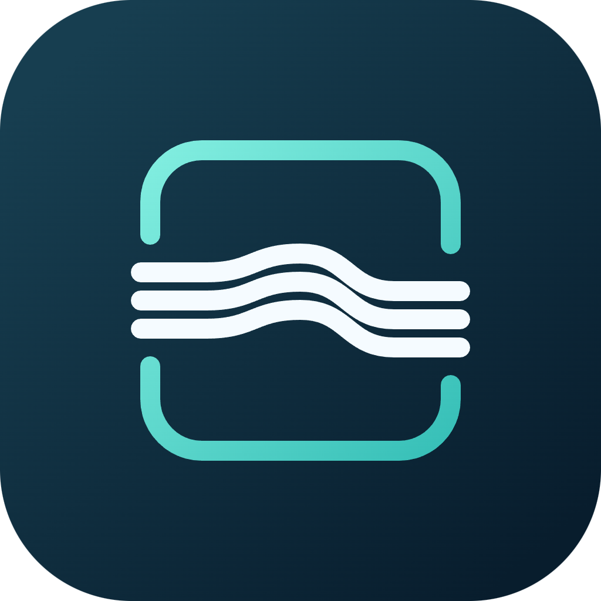
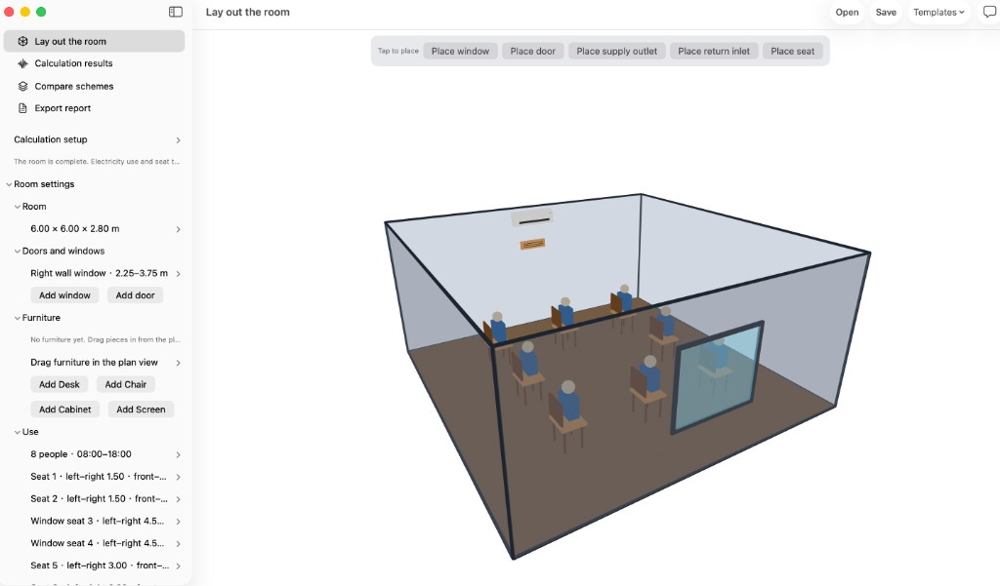
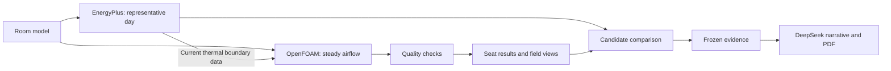

<p align="center">
  
</p>

<h1 align="center">SimuNow</h1>

<p align="center">
  <strong>Room-scale airflow, thermal comfort, and cooling energy in one native workspace.</strong>
</p>

<p align="center">
  English · <a href="README.zh-CN.md">简体中文</a>
</p>

<p align="center">
  <a href="#features">Features</a> ·
  <a href="#quick-start">Quick start</a> ·
  <a href="#how-it-works">How it works</a> ·
  <a href="#documentation">Documentation</a> ·
  <a href="#contributing">Contributing</a>
</p>

SimuNow is a Mac-first application for exploring air-conditioning layouts in offices and classrooms. Build a room, arrange seats and equipment, and compare how design choices affect airflow, seat-level comfort, and representative-day electricity use.

It brings **EnergyPlus** energy modelling and **OpenFOAM** computational fluid dynamics (CFD) into a shared room model, with native SwiftUI interfaces for macOS, iPhone, and iPad.



> [!IMPORTANT]
> SimuNow is an early-stage research prototype, currently built from source. Local simulations run on **Apple Silicon Macs in Debug builds**. iPhone and iPad support editing and viewing; production Release execution of the engines is not yet available.

## Features

- **Build a room visually.** Start with an office or classroom template; edit dimensions, orientation, doors, windows, furniture, seats, and split-AC supply and return terminals. Save the draft as a `.simunow` project.
- **Explore airflow and temperature.** Inspect room geometry in 3D, then view temperature slices, velocity arrows, streamlines, and seat temperatures from quality-passed CFD runs.
- **Evaluate comfort at each seat.** Calculate PMV/PPD thermal-comfort indices and the proportion of evaluated seats meeting the model's criteria, with missing inputs and exclusions disclosed.
- **Compare energy and operating cost.** Calculate representative-day cooling loads, estimate electricity use from the declared coefficient of performance (COP), and apply a configurable tariff.
- **Compare alternatives side by side.** Freeze candidate runs, inspect parameter differences, and compare results with a shared camera and temperature scale. Edited inputs mark older results as stale.
- **Explain and share results.** Discuss results with the in-app assistant and export comparison PDFs grounded in frozen evidence. These features require a DeepSeek API key. The interface supports Chinese and English.

### Example workflow

Start with the office template, run its energy and airflow calculations, and pin the results as a baseline. Change the supply-terminal height, recalculate, and pin a second candidate. Compare seat temperatures, comfort, and daily electricity cost before exporting a report.

## Platform support

| Capability | macOS | iOS / iPadOS |
|---|---|---|
| Room editing and result views | macOS 14+ | iOS / iPadOS 17+ |
| RealityKit 3D viewport | macOS 15+ | iOS / iPadOS 18+ |
| Viewport on earlier supported systems | Canvas wireframe | Canvas wireframe |
| Local EnergyPlus / OpenFOAM execution | Apple Silicon, Debug builds | Unavailable |

RoomPlan capture, remote computation, full-year energy simulation, multi-room and central-AC systems, transient cool-down, equipment quotations, and payback calculations are outside the current implementation. See the [delivery status](Plans/Delivery/status.md) for implementation and validation records.

## Quick start

### 1. Build and explore the app

You need **Xcode 16 or later** and the platform versions listed above. Engines and API keys are not required to edit a room.

```bash
git clone https://github.com/krabbypatty1031-blip/SimuNow.git
cd SimuNow
open SimuNow.xcodeproj
```

In Xcode, select **SimuNowMac** with the **Debug** configuration and run it on your Mac. For iPhone or iPad, select **SimuNowiOS** and an iOS simulator.

Create a project from the office or classroom template. You should be able to edit the room and inspect its geometry. Simulation controls remain unavailable until engines are configured.

### 2. Enable local simulations

On an **Apple Silicon Mac**, start Docker Desktop and ensure `python3`, `curl`, and `tar` are available. From the repository root:

```bash
# Downloads the pinned engines and weather data; run once.
test/engines/install_engines.sh

export SIMUNOW_ENGINES_ROOT="$PWD/test/engines"
PYTHONPATH=Backend/src python3 -m simunow_worker doctor
```

The probe should report `configured` for both `l1` (EnergyPlus) and `l2` (OpenFOAM). It checks configuration; a completed simulation provides separate evidence that the solver ran successfully.

In the Mac Debug app, select the same `test/engines` directory under **Compute setup**. Run the representative-day energy calculation (**L1**), followed by the steady airflow calculation (**L2**). Once L2 passes its quality checks, seat results and field overlays become available.

The engines are pinned to **EnergyPlus 25.2.0** and **OpenFOAM v2512** (`linux/arm64`, `buoyantBoussinesqSimpleFoam`). Engine binaries are installed separately and are not tracked in Git. See the [worker guide](Backend/README.md) for configuration details.

### 3. Enable the assistant and PDF reports

Provide a DeepSeek API key to the running app through `DEEPSEEK_API_KEY`—for an Xcode launch, set it in the scheme's Run environment—or a Keychain item with service `app.simunow.report` and account `DEEPSEEK_API_KEY`.

Pin the candidates you want to compare, then export from the report page. Export requires eligible comparison evidence and a successful DeepSeek response; without a key, room editing and local simulations remain available.

Energy and airflow calculations run locally. Assistant and report requests send their context or evidence to the DeepSeek API. Keep API keys out of project files and Git.

## How it works



1. **Model.** A shared draft records geometry, occupancy, HVAC parameters, weather day, comfort assumptions, and tariff. Setpoint, supply temperature, cooling load, electric power, airflow, and velocity retain separate meanings and units.
2. **Energy.** EnergyPlus evaluates a representative day, defaulting to 15 July in the Hong Kong CityUHK typical-year weather file. Electricity is estimated using the declared COP; the tariff determines daily cost.
3. **Airflow.** OpenFOAM solves a steady room case. A matching, current L1 result supplies window and wall thermal boundary data; otherwise the case retains the draft's declared boundary assumptions.
4. **Evaluate and compare.** Quality checks control the availability of seat samples and field views. Frozen candidates preserve their inputs, run identities, and results for comparison and reporting.

### Model scope and validation

- **Quality and freshness are separate.** Solver completion alone does not qualify a field for evaluation. Mesh, convergence, mass balance, and energy balance are checked; input hashes identify stale results.
- **Comfort is conditional.** PMV/PPD follows an implementation of ISO 7730 Annex D and requires air and radiant temperatures, air speed, humidity, clothing, and activity within the model's applicable range. Missing or out-of-range inputs produce an explanation rather than a fabricated score.
- **Interpret results within their scope.** Steady airflow does not predict cool-down time. One representative day does not establish annual savings. A modelled seat-pass ratio is not a measured occupant satisfaction rate.
- **Reports preserve their evidence.** Quantitative tables use frozen run data; a numerical guard filters generated narrative against that evidence. This does not establish the correctness of every qualitative recommendation.

The prototype supports exploratory comparisons. It has not established field-calibrated accuracy for arbitrary rooms. See the [validation plan](Plans/Delivery/validation.md), [verification records](Plans/Delivery/verification.md), and [known risks](Plans/Delivery/risks.md) for evidence and remaining gaps.

## Documentation

| Goal | Start here |
|---|---|
| Configure the Python worker and engines | [Backend guide](Backend/README.md) |
| Understand implemented capabilities | [Delivery status](Plans/Delivery/status.md) |
| Explore architecture and module boundaries | [Architecture](Plans/References/02-architecture.md) |
| Work with shared JSON formats | [Protocols and schemas](Protocols/README.md) |
| Inspect sample projects and results | [Fixtures](Fixtures/README.md) |
| Review project direction and decisions | [Plan index](Plans/README.md) · [Decision records](Plans/Delivery/decisions.md) |

Some planning documents retain historical descriptions; use delivery status together with the current source to determine what is implemented.

## Contributing

Bug reports, documentation improvements, and reproducible modelling or validation cases are welcome. Use [Issues](https://github.com/krabbypatty1031-blip/SimuNow/issues) for questions, bugs, and feature proposals. Include your platform, build configuration, reproduction steps, and relevant logs with private details removed.

Two native app targets share six modules in `Packages/SimuKit`: `SimuCore`, `SimuSimulation`, `SimuVisualization`, `SimuReporting`, `SimuDesignSystem`, and `SimuWorkspace`. The Python worker lives in `Backend/src/simunow_worker` and also uses solver and post-processing code in `test/p1`; that directory is a runtime dependency.

Read [AGENTS.md](AGENTS.md) and the [architecture notes](Plans/References/02-architecture.md) before making changes. From the repository root:

```bash
Scripts/check.sh test   # Shared Swift package tests
Scripts/check.sh mac    # macOS Debug build, code signing disabled
Scripts/check.sh ios    # iOS simulator build, code signing disabled
```

These checks do not validate the numerical engines. Changes to simulation behaviour also need the relevant Python tests and physical validation described in the project documentation. App target or build-configuration changes must be reflected in `Scripts/generate_project.py`.

## License

A project license has not yet been specified in this repository. Review the licensing terms before reusing or redistributing the code. Third-party engines and services have their own terms.

## Acknowledgements

Built with [SwiftUI](https://developer.apple.com/xcode/swiftui/), [RealityKit](https://developer.apple.com/augmented-reality/realitykit/), [EnergyPlus](https://github.com/NREL/EnergyPlus), and [OpenFOAM](https://www.openfoam.com/), with comfort evaluation based on [ISO 7730](https://www.iso.org/standard/39155.html).
