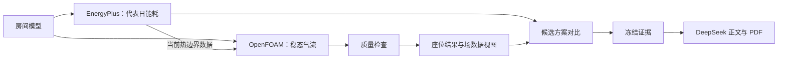

<p align="center">
  
</p>

<h1 align="center">SimuNow</h1>

<p align="center">
  <strong>在一个原生工作区中，分析室内气流、热舒适与空调能耗。</strong>
</p>

<p align="center">
  <a href="README.md">English</a> · 简体中文
</p>

<p align="center">
  <a href="#核心功能">核心功能</a> ·
  <a href="#快速开始">快速开始</a> ·
  <a href="#工作原理">工作原理</a> ·
  <a href="#文档导航">文档导航</a> ·
  <a href="#参与贡献">参与贡献</a>
</p>

SimuNow 是一款以 Mac 为主要平台的室内空调仿真与方案比较工具，面向办公室和教室等单房间场景。建立房间、布置座位与设备后，你可以比较不同配置对气流、座位热舒适和代表日用电的影响。

项目通过统一房间模型连接 **EnergyPlus 能耗模拟**与 **OpenFOAM 计算流体力学（CFD）模拟**，并提供适用于 macOS、iPhone 和 iPad 的原生 SwiftUI 界面。


> [!IMPORTANT]
> SimuNow 目前是需要从源码构建的早期研究原型。本地仿真仅支持 **Apple Silicon Mac 的 Debug 构建**；iPhone 和 iPad 支持编辑与查看，正式 Release 构建中的引擎执行尚未交付。

## 核心功能

- **可视化建立房间。** 从办公室或教室模板开始，编辑尺寸、朝向、门窗、家具、座位以及分体空调送回风口，并将草稿保存为 `.simunow` 项目。
- **查看气流与温度分布。** 在三维视图中查看房间几何；CFD 结果通过质量检查后，可查看温度切片、速度箭头、流线和座位温度。
- **逐座位评价热舒适。** 计算 PMV/PPD 热舒适指标和可评价座位中的模型达标比例，同时说明缺失输入与被排除的座位。
- **分析能耗与运行费用。** 计算代表日冷负荷，根据声明的能效比（COP）估算用电，并按可配置电价计算当天费用。
- **并排比较候选方案。** 冻结候选运行，查看参数差异，并使用共同镜头和温度色标比较结果；修改输入后，旧结果会标记为待重算。
- **解释与分享结果。** 通过应用内助手讨论结果，导出基于冻结证据的对比 PDF；这两项功能需要 DeepSeek API 密钥。界面支持中英文切换。

### 示例流程

从办公室模板开始，完成能耗与气流计算，将结果固定为基准。修改送风口高度，重新计算并固定第二个候选。在对比页查看座位温度、舒适度和当天电费的差异，再导出报告。

## 平台支持

| 能力 | macOS | iOS / iPadOS |
|---|---|---|
| 房间编辑与结果界面 | macOS 14+ | iOS / iPadOS 17+ |
| RealityKit 三维视口 | macOS 15+ | iOS / iPadOS 18+ |
| 较低受支持系统的视口 | Canvas 线框 | Canvas 线框 |
| 本地 EnergyPlus / OpenFOAM 执行 | Apple Silicon，Debug 构建 | 不支持 |

RoomPlan 扫描、远程计算、全年能耗模拟、多房间与中央空调、开机降温过程、设备报价和回收期计算尚未实现。具体实施与验证记录见[交付状态](Plans/Delivery/status.md)。

## 快速开始

### 1. 构建并体验应用

需要 **Xcode 16 或更新版本**，以及上表中的系统版本。编辑房间无需安装计算引擎或配置 API 密钥。

```bash
git clone https://github.com/krabbypatty1031-blip/SimuNow.git
cd SimuNow
open SimuNow.xcodeproj
```

在 Xcode 中选择 **SimuNowMac**，使用 **Debug** 配置在 Mac 上运行。体验 iPhone 或 iPad 界面时，选择 **SimuNowiOS** 和一个 iOS 模拟器。

从办公室或教室模板创建项目。此时应能编辑房间并查看几何；配置计算引擎前，仿真控件保持不可用。

### 2. 启用本地仿真

在 **Apple Silicon Mac** 上启动 Docker Desktop，并确保可以使用 `python3`、`curl` 和 `tar`。在仓库根目录执行：

```bash
# 下载固定版本的计算引擎与天气数据，首次配置时执行。
test/engines/install_engines.sh

export SIMUNOW_ENGINES_ROOT="$PWD/test/engines"
PYTHONPATH=Backend/src python3 -m simunow_worker doctor
```

探测结果中的 `l1`（EnergyPlus）和 `l2`（OpenFOAM）应均为 `configured`。这说明配置检查通过；求解器能否成功完成计算，需要由实际运行另行确认。

在 Mac Debug 应用的「计算准备」中选择同一个 `test/engines` 目录。先运行代表日能耗计算（**L1**），再运行稳态气流计算（**L2**）。L2 通过质量检查后，即可查看座位结果和场数据图层。

当前固定使用 **EnergyPlus 25.2.0** 与 **OpenFOAM v2512**（`linux/arm64`，`buoyantBoussinesqSimpleFoam`）。引擎单独安装，二进制不纳入 Git。配置细节见[计算端说明](Backend/README.md)。

### 3. 启用助手与 PDF 报告

向运行中的应用提供 DeepSeek API 密钥：使用环境变量 `DEEPSEEK_API_KEY`；从 Xcode 启动时，应将其配置在 scheme 的 Run 环境变量中。也可以在钥匙串中配置服务名为 `app.simunow.report`、账户名为 `DEEPSEEK_API_KEY` 的项目。

固定需要比较的候选后，从报告页导出。导出需要符合条件的对比证据，以及成功返回的 DeepSeek 响应；未配置密钥时，仍可编辑房间和运行本地仿真。

能耗与气流计算在本地执行。助手与报告请求会将相应上下文或证据发送至 DeepSeek API。请勿将 API 密钥写入项目文件或 Git。

## 工作原理



1. **建立模型。** 统一草稿记录几何、人员、空调参数、天气日期、舒适假设和电价。设定温度、送风温度、冷负荷、电功率、风量与风速分别保留各自的含义和单位。
2. **计算能耗。** EnergyPlus 模拟一个代表日，默认使用香港 CityUHK 典型年天气文件中的 7 月 15 日；用电按声明的 COP 估算，当天费用由电价决定。
3. **计算气流。** OpenFOAM 求解稳态房间工况。匹配当前输入的有效 L1 结果为窗户和墙体提供热边界；否则保留草稿声明的边界假设。
4. **评价与对比。** 质量检查决定座位采样与场数据能否用于展示。冻结候选保留各自的输入、运行身份和结果，供后续对比与报告使用。

### 模型范围与验证

- **质量与新鲜度独立。** 求解器运行结束不等于结果可用于评价；系统检查网格、收敛、质量与能量平衡，并通过输入哈希识别过期结果。
- **舒适评价有适用条件。** PMV/PPD 采用 ISO 7730 附录 D 的实现，需要适用范围内的气温、辐射温度、风速、湿度、衣着和活动量；缺项或超范围时显示原因。
- **结果按计算范围解读。** 稳态气流无法预测开机降温时间；单个代表日不能证明全年节能；模型达标座位比例不代表实测人员满意率。
- **报告保留证据来源。** 定量表格采用冻结运行数据，数字守卫依据证据过滤生成正文；这并不保证每条定性建议都正确。

当前原型用于探索性方案比较，尚未建立针对任意房间的现场校准精度。已有证据与待验证事项见[验证计划](Plans/Delivery/validation.md)、[验证记录](Plans/Delivery/verification.md)和[已知风险](Plans/Delivery/risks.md)。

## 文档导航

| 目标 | 阅读入口 |
|---|---|
| 配置 Python worker 与计算引擎 | [计算端说明](Backend/README.md) |
| 了解已实现的能力 | [交付状态](Plans/Delivery/status.md) |
| 理解架构与模块边界 | [系统架构](Plans/References/02-architecture.md) |
| 使用共享 JSON 格式 | [协议与 schema](Protocols/README.md) |
| 查看示例项目与结果 | [夹具说明](Fixtures/README.md) |
| 了解项目方向与设计选择 | [计划索引](Plans/README.md) · [决策记录](Plans/Delivery/decisions.md) |

部分计划文档保留了历史阶段描述，判断当前能力时请结合交付状态与实际源码。

## 参与贡献

欢迎问题反馈、文档改进，以及可复现的建模或验证案例。请通过 [Issues](https://github.com/krabbypatty1031-blip/SimuNow/issues) 提问、报告问题或提出功能建议，并附上平台、构建配置、复现步骤及去除私人信息后的相关日志。

两个原生应用共享 `Packages/SimuKit` 下的六个模块：`SimuCore`、`SimuSimulation`、`SimuVisualization`、`SimuReporting`、`SimuDesignSystem` 和 `SimuWorkspace`。Python worker 位于 `Backend/src/simunow_worker`，并复用 `test/p1` 中的求解与后处理代码；该目录也是运行时依赖。

修改前请阅读 [AGENTS.md](AGENTS.md) 与[架构说明](Plans/References/02-architecture.md)。在仓库根目录执行：

```bash
Scripts/check.sh test   # 共享 Swift 包测试
Scripts/check.sh mac    # macOS Debug 编译，关闭代码签名
Scripts/check.sh ios    # iOS 模拟器编译，关闭代码签名
```

这些检查不验证数值引擎。修改仿真行为后，还需执行文档中对应的 Python 测试与物理验证。修改应用 target 或构建配置时，应同步维护 `Scripts/generate_project.py`。

## 许可证

本仓库尚未指定项目许可证。复用或再分发代码前，请先确认许可条款；第三方计算引擎与服务遵循各自的条款。

## 致谢

项目使用 [SwiftUI](https://developer.apple.com/xcode/swiftui/)、[RealityKit](https://developer.apple.com/augmented-reality/realitykit/)、[EnergyPlus](https://github.com/NREL/EnergyPlus) 与 [OpenFOAM](https://www.openfoam.com/)，热舒适评价基于 [ISO 7730](https://www.iso.org/standard/39155.html)。
